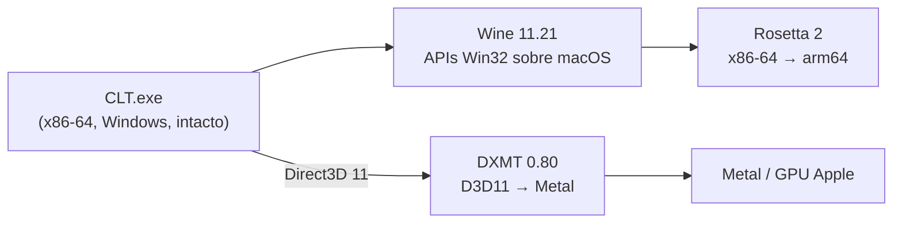

# C.L.T. no macOS

Empacota o **C.L.T.**, jogo da [Uniday Studio](https://uniday.studio/games/247-clt-early-access) em Acesso
Antecipado e só para Windows, num `CLT.app` que abre no macOS com dois cliques, sem CrossOver nem máquina virtual.

O repositório **não contém o jogo**. Ele guarda só o script que monta o app a partir do seu `CLT.exe`, comprado
na loja da Uniday. O `.exe` é de propriedade da Uniday Studio e está no `.gitignore`: não faça commit dele nem o
redistribua.

## Como funciona

O `CLT.exe` roda sem nenhuma modificação. O app traz junto as camadas de tradução:



| peça | origem | papel |
|---|---|---|
| Wine 11.21 | [Gcenx/macOS_Wine_builds](https://github.com/Gcenx/macOS_Wine_builds) | Win32, janela, input, áudio, rede e vídeo (Media Foundation via GStreamer) |
| DXMT 0.80 | [3Shain/dxmt](https://github.com/3Shain/dxmt) | Direct3D 11 traduzido para Metal |
| `winemac.so` corrigido | `packaging/wine-patches/` sobre o fonte do Wine 11.21 | expõe ao DXMT a view Metal da janela (ver abaixo) |
| Rosetta 2 | macOS | executa o código x86-64 em Apple Silicon |
| limitador de quadros | `packaging/framelimiter/` | `d3d11.dll` intermediária, ao lado do jogo: limita o FPS sem atrasar o mouse (ver abaixo) |

Como o binário não é alterado, **atualizar o jogo é só trocar o `.exe`** (ver "Atualizar o jogo").

### O patch no `winemac.so`

O DXMT procura no driver de macOS do Wine a tabela `macdrv_functions`, que só existe nos builds do CrossOver. Sem
ela, a tela fica preta e o log mostra `Failed to create metal view`. O patch tem dois arquivos:

- `dxmt_export.c` exporta a tabela e entrega ao DXMT os dados da janela no layout do CrossOver. Usa a content view
  da janela, porque o Wine 11 só cria uma view de cliente para GL/Vulkan.
- `dxmt_cocoa.m` põe a view Metal acima da superfície GDI da janela, que no Wine 11 fica por cima e esconderia
  cada frame.

O `build.sh` compila só esse módulo, com o mesmo fonte do Wine que gerou o resto do pacote.

### O limitador de quadros

Sem limite, o jogo roda a ~95–100 FPS e aquece o Mac. O limitador do próprio DXMT (`d3d11.preferredMaxFrameRate`)
segura o quadro antes de ele ir para a tela. Com isso, o jogo lê o mouse mais cedo, e na prática o mouse ficava
"agarrado".

O limitador deste pacote é uma `d3d11.dll` de ~14 KB, carregada antes da do DXMT (`d3d11=n,b`). Ela repassa
`D3D11CreateDeviceAndSwapChain` ao DXMT e troca o `IDXGISwapChain::Present` da swapchain criada por uma versão que
apresenta o quadro e só **depois** espera até o prazo do próximo. O jogo volta a ler o input logo após a espera, e
o quadro pronto não fica parado na fila. O consumo cai para o de 60 FPS, e o mouse responde como sem limite (testado
em tela cheia). O exe continua intacto.

## Requisitos

- Mac com Apple Silicon e macOS 13 ou mais novo.
- Rosetta 2: `softwareupdate --install-rosetta --agree-to-license`.
- Para compilar: Xcode Command Line Tools e Homebrew com `brew install mingw-w64 bison`.
- Cerca de 4 GB livres para downloads, fonte do Wine e o app.

## Montar o app

```bash
mkdir -p references && cp /caminho/do/CLT.exe references/CLT.exe
packaging/build.sh
open build/CLT.app
```

Na primeira execução, o `build.sh`:
1. baixa o Wine e o DXMT;
2. clona o Wine 11.21 e compila o `winemac.so` com o patch;
3. monta `build/CLT.app` com o ícone tirado do próprio `.exe`.

As execuções seguintes reaproveitam o que já está em `vendor/` e levam alguns segundos.

Para instalar, arraste `build/CLT.app` para `/Applications`. Na primeira abertura o app cria o prefixo do Wine em
`~/Library/Application Support/CLT/prefix`, o que leva uns 30 segundos. Saves, configurações e cache de shaders
ficam nesse prefixo, fora do app.

## Atualizar o jogo

Quando sair uma versão nova do C.L.T., baixe o `.exe` novo e rode:

```bash
packaging/build.sh --exe /caminho/do/CLT-novo.exe
```

Também dá para trocar o arquivo direto no app: `CLT.app/Contents/Resources/game/CLT.exe`. Os saves continuam no
prefixo.

## Opções

| variável | padrão | efeito |
|---|---|---|
| `CLT_MAX_FPS` | `60` | limite de quadros, aplicado pela `d3d11.dll` intermediária logo após cada `Present`. Aceita qualquer valor (por exemplo `90`); `0` desliga o limite |
| `WINEDEBUG` | `-all` | logs do Wine, por exemplo `fixme-all` para diagnóstico |
| `MTL_HUD_ENABLED` | — | `1` mostra o HUD do Metal: FPS, GPU e confirmação de que o DXMT está ativo |

Como passar as variáveis (feche o jogo antes de abrir de novo com outro valor):

```bash
open build/CLT.app                               # padrão: 60 FPS
open --env CLT_MAX_FPS=45 build/CLT.app          # mais frio e silencioso
open --env CLT_MAX_FPS=90 build/CLT.app          # mais fluido, mais quente
open --env CLT_MAX_FPS=0 build/CLT.app           # sem limite (~95–100 FPS num M2 Max)
open --env MTL_HUD_ENABLED=1 build/CLT.app       # HUD do Metal: FPS, tempo de GPU, DXMT ativo
open --env CLT_MAX_FPS=45 --env MTL_HUD_ENABLED=1 build/CLT.app   # dá para combinar
```

Se o app estiver em `/Applications`, troque `build/CLT.app` por `/Applications/CLT.app`.

Os logs ficam em `~/Library/Application Support/CLT/`: `clt.log` (Wine) e `CLT_d3d11.log` (DXMT).

## Desempenho e temperatura

### Histórico do limite de quadros

| tentativa | resultado |
|---|---|
| sem limite | mouse solto, mas ~95–100 FPS, GPU no máximo e fans altas |
| limitador do DXMT (`d3d11.preferredMaxFrameRate=60`) | 60 FPS, mas o mouse fica "agarrado": o Metal segura o quadro antes da tela, e o jogo lê o input mais cedo |
| `d3d11.dll` intermediária (atual) | 60 FPS e mouse igual a sem limite: a espera vem **depois** do `Present` (ver "O limitador de quadros") |

### De onde vem o calor

Medido no M2 Max em partida, a 60 FPS, no preset gráfico "Alta" (o padrão do jogo):

| medida | valor |
|---|---|
| CPU do `CLT.exe` (`top`) | ~2–8% de um núcleo |
| utilização da GPU (`ioreg -r -c IOAccelerator`) | 50–90% |
| GPU por quadro (HUD do Metal) | 10–11 ms, com picos de 23 ms |

O gargalo é a GPU, pelo trabalho que o próprio jogo pede. A tradução feita pelo Rosetta e pelo Wine pesa pouco. O exe
descreve assim os presets de "Qualidade Gráfica":

| preset | MSAA | sombra do sol | HBAO | bloom/FXAA |
|---|---|---|---|---|
| Muito Baixa | não | sem sombra | não | não |
| Baixa | não | 1024 | não | sim |
| Média | 2x | 2048 | sim | sim |
| Alta | 4x | 4096 | sim | sim |

Temperaturas na casa dos 94 °C sob carga de GPU estão dentro do que o chip aguenta: ele reduz o clock sozinho antes
de qualquer risco. O incômodo é o barulho das fans. Para esfriar, do maior efeito para o menor:

1. **Gráficos no jogo** (Configurações → Gráficos): "Qualidade Gráfica" Média ou Baixa, e "Resolução da Cena" 75%
   (cerca de 44% menos pixels).
2. **Limite de FPS menor:** o trabalho da GPU cai quase na proporção. A 45 FPS é uns 25% a menos que a 60
   (`open --env CLT_MAX_FPS=45 build/CLT.app`).
3. **Modo de Pouca Energia do macOS** (Ajustes → Bateria, ou `sudo pmset -a lowpowermode 1`): reduz o clock da GPU
   e da CPU, ao custo de alguns FPS.

Ponto de partida sugerido: Média com 75% de resolução, a 60 FPS. Se ainda esquentar, baixe o limite para 45.

## Estrutura

| caminho | conteúdo |
|---|---|
| `packaging/build.sh` | monta `build/CLT.app` (downloads, compilação do `winemac.so`, montagem e ícone) |
| `packaging/launcher.sh` | executável do app: cria o prefixo, aplica o limite de FPS e abre o jogo |
| `packaging/wine-patches/winemac.drv/` | patch do driver macOS do Wine para o DXMT |
| `packaging/brand_loader.py` | troca "Wine" por "CLT" no nome do app na barra de menus |
| `packaging/make_icon.py` | gera o `.icns` a partir do ícone do `.exe` |
| `packaging/framelimiter/` | `d3d11.dll` intermediária com o limitador de quadros (compilada com mingw-w64) |
| `packaging/Info.plist` | metadados do bundle |

## Estado

Testado num MacBook Pro M2 Max com macOS 26.6.2 e C.L.T. 0.5.0, em tela cheia a 1728×1117:

- abertura, tela de boas-vindas, menus e geração de mapa aleatório (Pequeno) funcionam;
- no jogo, HUD, minimapa, NPCs, trânsito e polícia aparecem, e mouse e teclado respondem (o celular abre com
  `SETA CIMA`);
- a renderização sai pelo Metal via DXMT, com apresentação `Direct`. O limitador mantém ~60 FPS (HUD: 58–60 FPS,
  17 ms por quadro), contra ~95–100 FPS sem limite, e o mouse responde como sem limite;
- o C.L.T. procura atualização sozinho ao abrir, e o acesso à rede passa pelo WinHTTP do Wine;
- o áudio sai pelo CoreAudio (`winecoreaudio.so`): com o jogo aberto, o `coreaudiod` mantém um stream de saída
  ativo nos alto-falantes, e ele some quando o jogo fecha (`pmset -g assertions`).

Não verificados ainda: controle (gamepad), partidas longas, mapas Gigante/Colossal e o botão "Enviar Feedback".

## Licenças

C.L.T. © Uniday Studio. Wine é LGPL-2.1. DXMT 0.80 é MIT. Os scripts deste repositório são de uso pessoal para rodar
uma cópia legítima do jogo.
